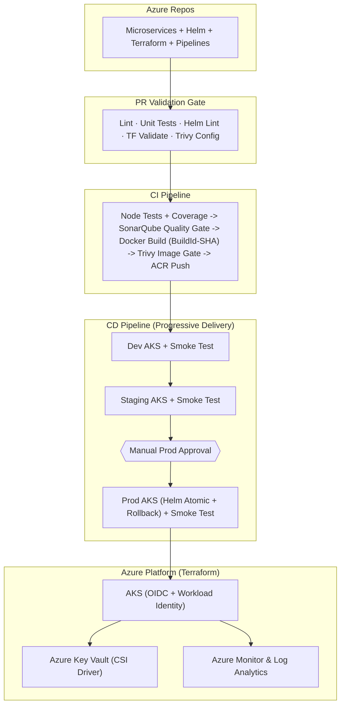

# Enterprise Azure DevOps CI/CD Platform with AKS

An enterprise-grade, multi-team CI/CD platform built on **Azure DevOps**, **Azure Kubernetes Service (AKS)**, **Azure Container Registry (ACR)**, **Helm**, **Terraform**, **SonarQube**, **Trivy**, **Azure Key Vault**, and **Azure Monitor**.

## Architecture



## Repository Structure

```text
├── charts/microservices-app/     # Multi-environment Helm chart with Key Vault CSI & NetworkPolicy
├── docs/                         # Architecture, branch policies, cost assumptions, manual setup, troubleshooting
├── pipelines/
│   ├── templates/                # Reusable CI, CD, smoke test, and notification YAML templates
│   ├── azure-pipelines-pr.yml    # PR validation gate
│   ├── azure-pipelines-ci.yml    # CI build, SonarQube, Trivy, ACR push, Helm packaging
│   └── azure-pipelines-cd.yml    # Dev -> Staging -> Approval-gated Prod CD with rollback
├── scripts/                      # Smoke test, Helm rollback, cleanup, and local validation scripts
├── security/                     # RBAC & Workload Identity documentation
├── services/
│   ├── backend/                  # Orders REST microservice + unit tests + hardened Dockerfile
│   └── frontend/                 # Web portal microservice + unit tests + hardened Dockerfile
└── terraform/
    ├── modules/{acr,aks,keyvault,monitoring}/
    └── environments/{dev,staging,prod}.tfvars
```

## Key Capabilities

- **Reusable Pipeline Templates:** Parameterized YAML templates separate CI scanning, AKS Helm deployment, smoke testing, and failure notifications.
- **Immutable Image Tagging:** Images are tagged with `$(Build.BuildId)-$(Build.SourceVersion)` for deterministic rollouts and rollbacks.
- **Shift-Left Security:** PR and CI gates enforce unit test coverage, SonarQube Quality Gate, Trivy filesystem/IaC/image scans, and non-root containers.
- **Zero-Static-Secret Auth:** Uses Azure DevOps Workload Identity Federation and AKS OIDC Workload Identity with Key Vault CSI integration.
- **Controlled Production Rollout & Rollback:** Production requires Azure DevOps Environment approval; Helm runs `--atomic --wait` with explicit `helm rollback` fallback.

## Local Validation

Run unit tests and Terraform checks locally (no Azure subscription required):

```powershell
./scripts/validate.ps1
```

## Manual Azure Configuration

See [docs/manual-azure-setup.md](./docs/manual-azure-setup.md) for the exact Azure and Azure DevOps prerequisites (Terraform remote state storage, WIF service connections, SonarQube connection, variable groups, and production environment approvals).
