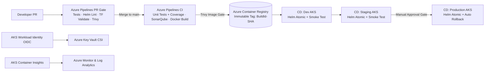

# Architecture Overview

## Immutable Image Tagging Strategy
Every CI build tags images with `$(Build.BuildId)-$(Build.SourceVersion)` and `sha-$(Build.SourceVersion)`. `latest` is never used in Helm values or CD deployments, ensuring deterministic rollbacks and exact commit-to-pod auditability.
